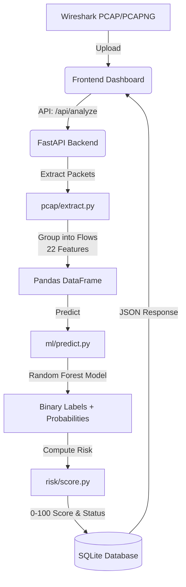

# Cyber Attack Detection System — Architecture

This document provides a comprehensive overview of the architecture of the **Detection of Cyber Attack in Network Using Machine Learning Technique** project.

## 1. High-Level Data Flow

The system processes network traffic through a sequential pipeline:



## 2. Technology Stack

*   **Frontend**: Vanilla HTML5, CSS3 (Modern SOC Dashboard theme), JavaScript (Fetch API). No heavy frameworks (React/Angular) are used to keep the architecture simple and lightweight.
*   **Backend**: FastAPI (Python 3.x). Handles both API endpoints and serving static frontend files.
*   **Network Processing**: Scapy. Used for parsing `.pcap` and `.pcapng` files and extracting raw packet data.
*   **Data Manipulation**: Pandas & NumPy. Used for aggregating packet data into network flows and calculating statistical features (mean, std dev, min, max).
*   **Machine Learning**: Scikit-Learn. Uses a `Pipeline` containing a `SimpleImputer` (for handling missing values) and a `RandomForestClassifier` (for robust classification).
*   **Database**: SQLite (`cyber_attacks.db`). A lightweight, serverless database used to store capture history, risk scores, and simulated blocked IPs.

## 3. Core Modules

The backend is structured into specialized, decoupled modules:

### A. `backend/pcap/extract.py` (Feature Extraction)
This is the most computationally intensive part of the pipeline.
1.  **Packet Parsing**: Reads the uploaded capture file using Scapy.
2.  **Flow Grouping**: Groups individual packets into bidirectional "flows" based on the 5-tuple: `(Source IP, Dest IP, Source Port, Dest Port, Protocol)`.
3.  **Feature Calculation**: For each flow, it calculates exactly 22 numerical features. These features include:
    *   Basic identifiers (Ports, Protocol)
    *   Volume metrics (Total Fwd Packets, Total Length of Fwd Packets)
    *   Length statistics (Fwd Packet Length Max/Min/Mean/Std)
    *   Time statistics (Flow IAT Mean/Std/Max/Min)
    *   Flags (FIN, SYN, RST, PSH, ACK, URG)

### B. `backend/ml/predict.py` (Machine Learning)
Handles model loading and inference.
1.  **Lazy Loading**: The Random Forest model (`models/random_forest_pipeline.joblib`) is loaded into memory only when needed or during server startup to minimize cold-start times.
2.  **Prediction**: Takes the 22-feature Pandas DataFrame and outputs two things for each flow:
    *   Binary label: `Normal` or `Attack`
    *   Attack Probability: A float between 0.0 and 1.0 indicating confidence.
3.  **Summarization**: Aggregates the per-flow predictions into a capture-level summary (e.g., total flows, attack flows, top suspicious IPs).

### C. `backend/risk/score.py` (Risk Analysis)
Translates raw ML metrics into a human-readable risk assessment.
1.  **Risk Score (0-100)**: Calculated using a weighted formula defined in `config/risk_config.json`:
    *   *Attack Ratio (50%)*: Percentage of flows classified as attacks.
    *   *Mean Probability (30%)*: Average confidence of the attack predictions.
    *   *Volume Factor (20%)*: Scales risk based on the total volume of traffic (more traffic = higher potential impact).
2.  **Risk Level**: Categorizes the score into `LOW` (< 30), `MEDIUM` (30-70), or `HIGH` (> 70).
3.  **Status**: Returns `ATTACK` if the risk score exceeds the `attack_threshold` (default 50), otherwise `NORMAL`.

### D. `backend/database/db.py` (Storage)
Handles persistence using SQLite.
1.  **`captures` table**: Stores the summary of each uploaded file (filename, date, risk score, total/attack flows).
2.  **`suspicious_flows` table**: Stores the top highest-probability attack flows for display on the dashboard.
3.  **`simulated_blocks` table**: Stores IPs that the user has chosen to "block" via the dashboard UI (for demonstration purposes only).
4.  **Auto-cleanup**: Runs a background thread to delete physical `.pcap` files older than 24 hours to prevent disk exhaustion, while keeping the analysis records in the database.

### E. `backend/training/train.py` (Offline Training)
This script is run *offline* to generate the model. It is not part of the runtime web application.
1.  Loads the massive CIC-IDS2017 CSV dataset.
2.  Filters down to the selected 22 features defined in `config/feature_schema.json`.
3.  Cleans data (handles NaNs, duplicates).
4.  Splits data into 80% training / 20% testing sets.
5.  Trains the Random Forest model and evaluates it (Accuracy, F1, ROC-AUC).
6.  Serializes the model to disk using `joblib`.

## 4. Security & Robustness

*   **File Validation**: The API rigorously checks file extensions and enforces a maximum upload size (50MB) to prevent memory exhaustion during Scapy processing.
*   **UUID Filenames**: Uploaded files are immediately renamed to random UUIDs to prevent path traversal attacks and filename collisions.
*   **XSS Prevention**: The Vanilla JS frontend explicitly escapes all data received from the API before rendering it into the DOM.
*   **SQL Injection Prevention**: All SQLite queries use parameterization (`?`).
*   **Model Security**: The prediction module only loads `.joblib` files from the specific, restricted `models/` directory.

## 5. Directory Structure Map

```text
Mini_Project/
├── backend/                  # Core application logic
│   ├── main.py               # FastAPI entry point & API routes
│   ├── pcap/                 # Packet processing logic
│   ├── ml/                   # Machine learning inference
│   ├── risk/                 # Risk scoring logic
│   ├── database/             # SQLite DB interactions
│   └── training/             # Offline model training scripts
├── frontend/                 # UI (HTML/CSS/JS)
├── config/                   # System configuration (JSON)
├── models/                   # Serialized ML model (.joblib) & metadata
├── data/                     # Raw datasets & test PCAPs
├── docs/                     # Documentation & reports
├── tests/                    # Automated testing suite
└── uploads/                  # Temporary storage for user uploads
```
